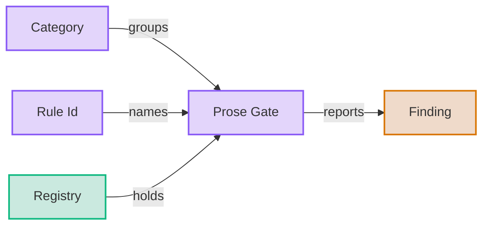
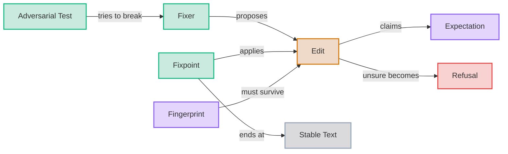
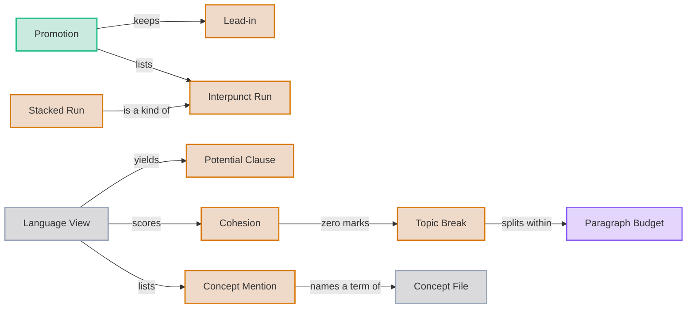
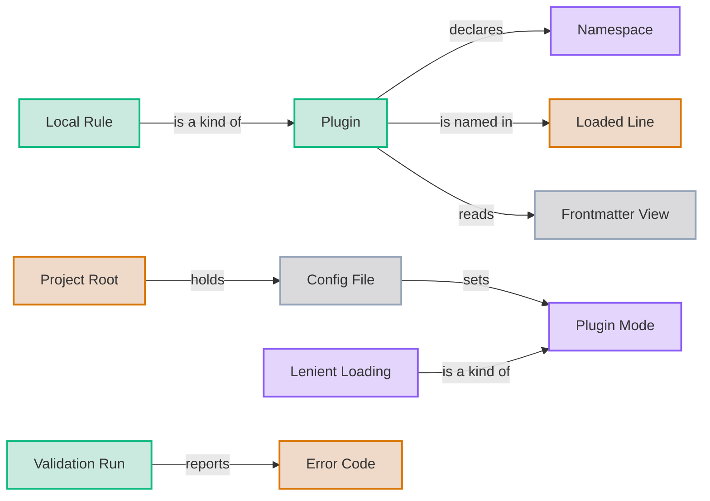
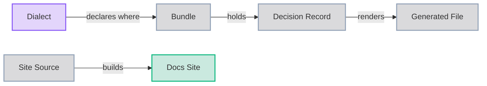
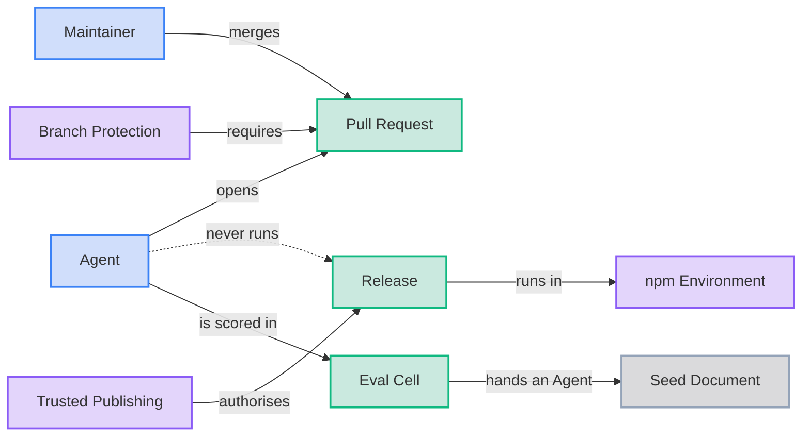

# Glossary

The ubiquitous language for `jpai-prose-gates`.
Each term is written in Title Case wherever it is used, to mark it as this glossary's meaning rather than the plain-language one.
When a new domain term enters the code or the conversation, add it here in the same change.
Give it its own H2 and a place in the diagram.

One diagram of every term would fail the diagram complexity gates, so the diagram is split into six, one per area.

The rules and what they report.

How a fix is proposed, verified and settled.

Lists hidden in prose, and the language of sentences and paragraphs.

Plugins, config and loading.

Decisions, generated files and the docs site.

Who changes the repo, how a change ships, and how agents are measured.

## Adversarial Test

A hostile input written to break a Fixer, asserting a Refusal or an exact safe output.
See [PRS-0009](adrs/0009-adversarial-and-property-tests-gate-fixes.md).

## Agent

An AI coding assistant working in this repo, such as Claude Code or Codex.
Every Agent is bound by the instructions in `CLAUDE.md`.

## Branch Protection

The GitHub rule on main that requires a Pull Request and passing CI, for admins too.

## Bundle

The `adrs/` directory as a whole, including the Decision Records and everything generated from them.

## Category

The group a Prose Gate belongs to: sentence, paragraph, list or punctuation, or a one-word Category a Plugin declares.
See [PRS-0011](adrs/0011-rules-carry-a-category.md).

## Cohesion

How strongly a sentence holds on to its neighbours, from shared word lemmas and an opening word that refers back.
Zero marks a Topic Break.
See [PRS-0030](adrs/0030-paragraph-length-is-reported-with-topic-guidance.md).

## Concept File

The `GLOSSARY.md` or `CONCEPTS.md` at the Project Root, read once per run as the project's vocabulary.
Each H2 is a term, and each diagram edge relates two terms.
One that does not parse stops the run.
See [PRS-0036](adrs/0036-a-glossary-is-read-as-the-concept-model.md).

## Concept Mention

One place a sentence of the Language View names a term of the Concept File.
It matches in any case and in the plural, and a multi-word term matches as one unit.

## Config File

The optional `prose-gates.config.json` or `.mjs` that switches rules off and sets their options.
See [PRS-0018](adrs/0018-config-file-and-rule-control.md).

## Decision Record

One decision, authored as YAML in `adrs/`.
Its markdown is generated and never edited.

## Dialect

This repo's declared documentation conventions, in [docs/CONVENTIONS.md](docs/CONVENTIONS.md).

## Docs Site

The MkDocs Material site on GitHub Pages, built from the real documents and deployed only from main.
See [PRS-0029](adrs/0029-the-docs-site-is-assembled-from-the-real-documents.md).

## Edit

A proposed change: a start offset, an end offset, replacement text and an Expectation.

## Error Code

The stable kebab-case name of a failure, such as unknown-rule or plugin-contract, shown as error[code] and carried on the error class.
See [PRS-0024](adrs/0024-failures-are-named-errors-with-codes.md).

## Eval Cell

One agent run of one eval case on one model, graded by the gates and by content preservation.
Its pass, turns and cost show how well a Finding's message closes the loop.
See [PRS-0035](adrs/0035-finding-messages-are-measured-by-agent-evals.md).

## Expectation

What an Edit claims about the reparsed tree: same-tree, same-shape, same-frontmatter-data or replace-paragraph.

## Finding

One reported violation of a Prose Gate, with a file, a line, a Rule Id and a message.

## Fingerprint

Every word, url, alt text and code value of a document in order.
A fix must preserve it.
See [PRS-0005](adrs/0005-every-fix-is-verified.md).

## Fixer

The optional fix function of a rule.
It proposes Edits and never writes files itself.

## Fixpoint

The engine's loop of applying verified Edits in a fixed rule order until nothing changes.

## Frontmatter View

A leading YAML block as its parsed document plus every string in it at any depth.
Each string carries a path, a line and source offsets, and only plugin rules read the view.
See [PRS-0023](adrs/0023-frontmatter-is-a-read-only-view.md).

## Generated File

A file rendered from a source by the repo's regenerate command, and never edited by hand.
Everything in `adrs/` except the Decision Records is one, and so is `dist/`.

## Interpunct Run

Items joined by the middle dot glyph inside one paragraph.

## Language View

A paragraph's sentences, and each sentence's words with tags and lemmas, from ParagraphView.language.
Built on first read.
See [PRS-0033](adrs/0033-a-paragraph-carries-a-lazy-language-view.md).

## Lead-in

The text before a promoted list, ending in a colon.

## Lenient Loading

A Plugin Mode that leaves a failed Plugin out, names it on stderr with its code, and runs the rest.

## Loaded Line

The one stderr line a run prints naming each Plugin Namespace it loaded and how many rules it brought.

## Local Rule

A plugin rule that is one file in `.prose-gates/rules`, under the reserved Namespace local.
See [PRS-0022](adrs/0022-plugins-load-automatically.md).

## Maintainer

The owner of this repo.

## Namespace

The word before the slash in a plugin Rule Id, such as acme in acme/sentence-no-passive-voice.
A core id has none.

## npm Environment

The GitHub environment the publish job runs in.
It admits only main.

## Paragraph Budget

The most sentences a paragraph may hold, set by the maxSentences option of paragraph-sentence-budget-exceeded and 5 by default.
See [PRS-0030](adrs/0030-paragraph-length-is-reported-with-topic-guidance.md).

## Plugin

A module that adds rules to a run, with a name, a Namespace, a contract version and optional Categories.
See [PRS-0019](adrs/0019-plugin-contract-and-namespace.md).

## Plugin Mode

How a Plugin that fails to load is treated: off, strict, lenient or collect.
Strict stops the run and is the default.
See [PRS-0025](adrs/0025-plugin-loading-strictness.md).

## Potential Clause

A span of a sentence bounded by a clause marker.
sentence-word-budget-exceeded counts them to suggest how many sentences a split needs.
See [PRS-0010](adrs/0010-length-findings-guide-a-split.md) and [PRS-0034](adrs/0034-clauses-count-verb-phrases-as-well-as-markers.md).

## Project Root

The nearest ancestor of the working directory with a package.json, a Config File or a `.prose-gates` directory.

## Promotion

Turning an inline hidden list into a Lead-in and a real markdown list.

## Prose Gate

One deterministic markdown rule, identified by a Rule Id.
Also called a rule in code.

## Pull Request

The only way a change lands on main.
It merges once both CI checks pass.
See [PRS-0014](adrs/0014-main-changes-only-through-pull-requests.md).

## Refusal

A Fixer or the verifier declining an Edit.
The source is untouched and the Finding stays.
See [PRS-0004](adrs/0004-a-fixer-refuses-when-unsure.md).

## Registry

The rules a run uses: the built-ins plus loaded Plugins, with the config applied.

## Release

One version published to npm by the Publish workflow, with a matching tag and GitHub release.
See [PRS-0013](adrs/0013-releases-publish-from-github-actions.md).

## Rule Id

The name of a Prose Gate, written category-short-name, such as sentence-one-per-line.
The Category is one lower-case word and the short name is three or four words.
See [PRS-0017](adrs/0017-rule-ids-are-category-and-short-name.md).

## Seed Document

The markdown file an Eval Cell hands an Agent, failing exactly one Prose Gate.

## Site Source

The untracked copy of the documents at `tmp/site-src` that MkDocs reads, rebuilt by `scripts/assemble-site.ts` and never edited.

## Stable Text

The text a fix run ends at.
No Fixer, asked again after the last accepted Edit, has a verifiable Edit left, so fixing it again changes nothing.

## Stacked Run

Interpunct Runs on consecutive lines, each with a label.
Promoted to a nested list.

## Topic Break

A gap between two sentences with no Cohesion.
paragraph-sentence-budget-exceeded counts topics from them and suggests a paragraph break at each.

## Trusted Publishing

npm accepting an upload from a named GitHub workflow in place of a stored token.

## Validation Run

A run of --validate-plugins, which loads every Plugin, reports every failure, and runs no check or fix.
