# The language and concept models

How a Prose Gate reads English, and how it learns a project's own words.

Read this before writing a rule that reads `language` or `doc.concepts`.
It is the map behind `src/language.ts`, `src/concepts.ts` and `src/cohesion.ts`.

[Writing plugins and local rules](plugins.md#language) lists the fields a rule can read.
This page shows how each field is built, what it is good for and where it goes wrong.
Each lens shows an overview first, then a detailed reference you can open.

## Contents

- [Two models, one view](#two-models-one-view)
- [Built on first read](#built-on-first-read)
- [A sentence, word by word](#a-sentence-word-by-word)
- [When the tagger is wrong](#when-the-tagger-is-wrong)
- [The Concept File](#the-concept-file)
- [Finding concepts in a sentence](#finding-concepts-in-a-sentence)
- [Cohesion and Topic Breaks](#cohesion-and-topic-breaks)
- [Who reads what](#who-reads-what)
- [Limits](#limits)

## Two models, one view

There are two models behind the Language View.

The **language model** is general English.
compromise splits prose into sentences, tags each word with its parts of speech and gives its lemma.
It knows nothing about the project.

The **concept model** is the project's own vocabulary.
It is read from the Concept File, the `GLOSSARY.md` or `CONCEPTS.md` at the Project Root.
It knows the project's terms and how they relate, and nothing about grammar.

The Language View joins them.
Each sentence carries its tagged words, and also each place it names a term of the Concept File.

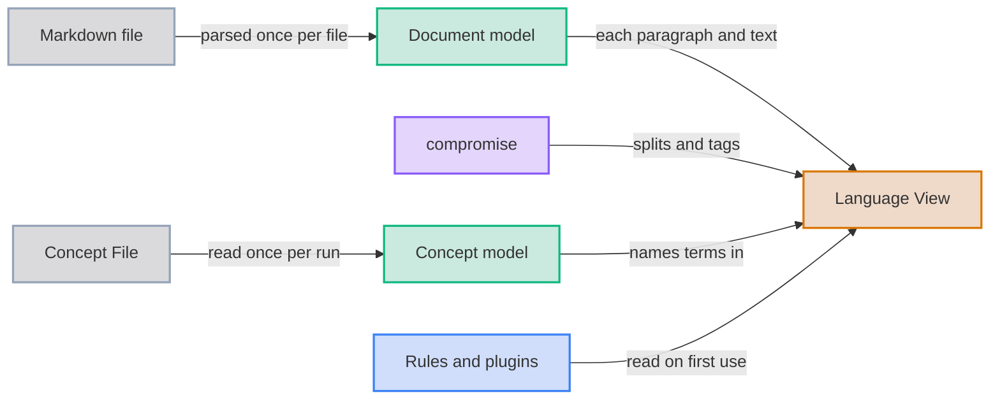

*Overview: the document model and the concept model meet in the Language View, which rules read.*

<details>
<summary>Detail: the functions that build each model</summary>

```mermaid
flowchart LR
    subgraph Run["Once per run, src/project.ts"]
        SU["setUp"]:::pipeline
        FC["findConcepts"]:::pipeline
        PC["parseConcepts"]:::pipeline
        CM["ConceptModel"]:::record
        RG["Registry"]:::record
    end
    subgraph File["Once per file, src/model.ts"]
        BD["buildDocModel"]:::pipeline
        PV["ParagraphView"]:::record
        TV["TextView"]:::record
        PR["prose, inline code as CODE"]:::info
        VA["value"]:::info
    end
    subgraph Lang["On first read, src/language.ts"]
        LO["languageOf"]:::pipeline
        ST["sentenceTexts"]:::pipeline
        TG["tag"]:::pipeline
        MI["mentionsIn"]:::pipeline
        LV["LanguageView"]:::record
    end
    subgraph Read["Readers"]
        SW["sentence-word-budget-exceeded"]:::rule
        PS["paragraph-sentence-budget-exceeded"]:::rule
        CO["src/cohesion.ts"]:::rule
        PL["Plugin rules"]:::people
    end

    SU --> FC --> PC --> CM --> RG
    RG -- concepts --> BD
    BD --> PV --> PR
    BD --> TV --> VA
    PR -- paragraph --> LO
    VA -- text --> LO
    LO --> ST --> TG --> LV
    TG --> MI --> LV
    LV --> SW & PS & PL
    PS --> CO

    classDef people    fill:#2563eb36,stroke:#3b82f6,stroke-width:2px
    classDef info      fill:#b4530936,stroke:#d97706,stroke-width:2px
    classDef rule      fill:#7c3aed36,stroke:#8b5cf6,stroke-width:2px
    classDef pipeline  fill:#05966936,stroke:#10b981,stroke-width:2px
    classDef record    fill:#52525b36,stroke:#94a3b8,stroke-width:2px
```

*Detail: the concept model is loaded with the Registry, and every document model built in the run carries it.*

The shapes a rule reads, and how they nest.

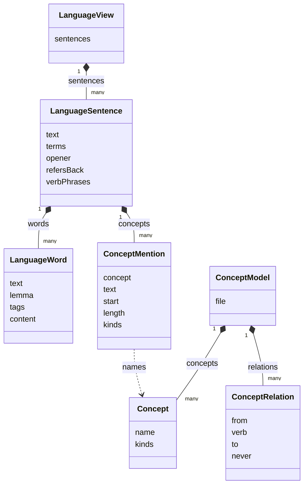

*Detail: a mention points at a concept by name, so a rule can look the concept up in `doc.concepts`.*

</details>

## Built on first read

Tagging is the slowest step of a check.
So the Language View is a getter that builds the view the first time a rule reads it, and keeps it.
A document that no rule reads for language is never tagged.

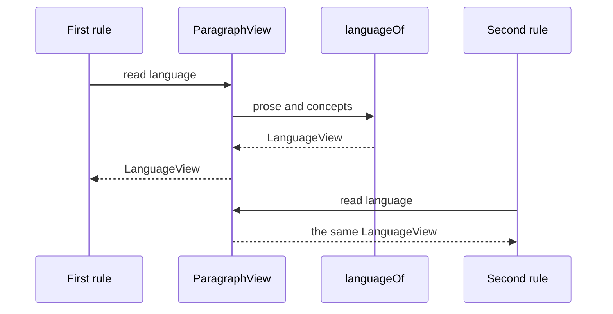

*Overview: the first read builds the view, and every later read returns the same object.*

<details>
<summary>Detail: what one build does, and when a new one happens</summary>

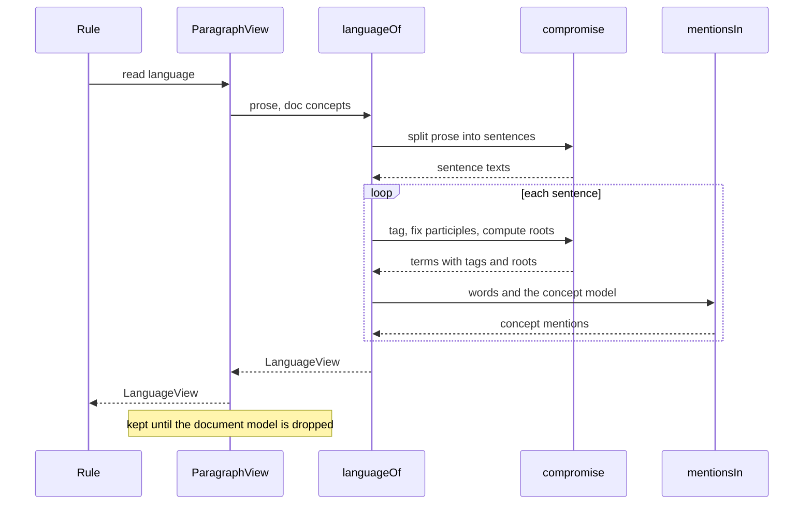

*Detail: one compromise pass splits, then one pass per sentence tags and matches.*

</details>

The view lives as long as its document model, and no longer.
The fix engine builds a fresh document model after every Edit, so a view never describes source that has changed.
A fence tagged `markdown` gets a document model of its own, with the same concepts.

## A sentence, word by word

A paragraph's view reads its `prose`, where each inline code span is the single token `CODE`.
A text view reads its `value`, which holds no inline code at all.

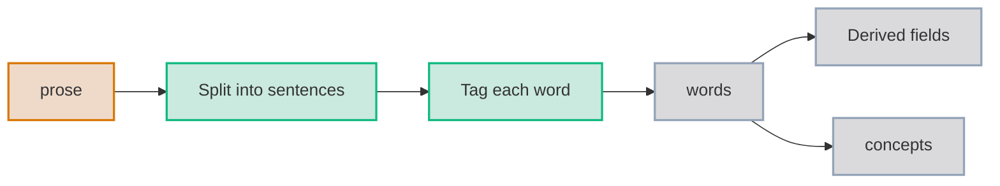

*Overview: split, tag, then read every other field off the tagged words.*

<details>
<summary>Detail: the rule behind each derived field</summary>

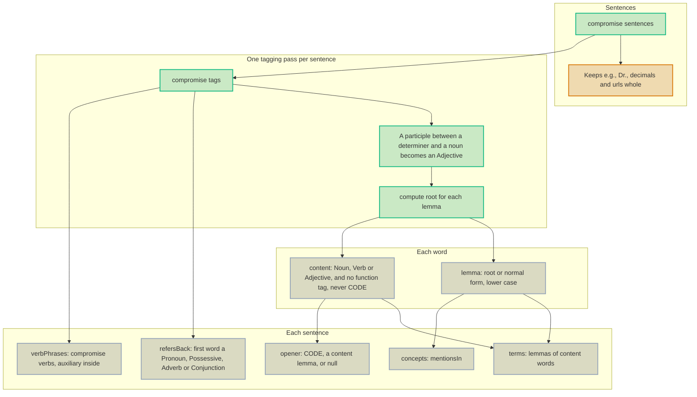

*Detail: the function tags are Pronoun, Possessive, Auxiliary, Copula, Modal and Determiner.*

</details>

Here is one sentence and the view built from it.
`tests/language-doc.test.ts` builds the view again from the sentence, so the two cannot drift.

```text title="Sentence"
Then the engine applies the edit and checks the document again.
```

```json title="Language view"
{
  "text": "Then the engine applies the edit and checks the document again.",
  "words": [
    { "text": "Then", "lemma": "then", "tags": ["Adverb"], "content": false },
    { "text": "the", "lemma": "the", "tags": ["Determiner"], "content": false },
    { "text": "engine", "lemma": "engine", "tags": ["Noun", "Singular"], "content": true },
    { "text": "applies", "lemma": "apply", "tags": ["Verb", "PresentTense"], "content": true },
    { "text": "the", "lemma": "the", "tags": ["Determiner"], "content": false },
    { "text": "edit", "lemma": "edit", "tags": ["Noun", "Singular"], "content": true },
    { "text": "and", "lemma": "and", "tags": ["Connector", "Conjunction"], "content": false },
    { "text": "checks", "lemma": "check", "tags": ["Verb", "PresentTense"], "content": true },
    { "text": "the", "lemma": "the", "tags": ["Determiner"], "content": false },
    { "text": "document", "lemma": "document", "tags": ["Noun", "Singular"], "content": true },
    { "text": "again", "lemma": "again", "tags": ["Adverb"], "content": false }
  ],
  "terms": ["engine", "apply", "edit", "check", "document"],
  "opener": null,
  "refersBack": true,
  "verbPhrases": 2,
  "concepts": []
}
```

Read it field by field.

- **`lemma` folds inflections together.** "applies" and "apply" share the lemma `apply`, so two sentences can share a term without sharing a spelling.
- **`content` drops the glue words.** Determiners, connectors and adverbs carry no topic, so they never reach `terms`.
- **`opener` is null here.** "Then" is not a content word, so the sentence has no topic word in first place.
- **`refersBack` is true.** "Then" is an adverb, so the sentence leans on the one before it.
- **`verbPhrases` is two.** "applies" and "checks" each head a verb phrase, which makes two Potential Clauses.

## When the tagger is wrong

compromise is a statistical tagger, and its tags are a guide rather than a parse.
It reads some technical verbs as nouns.

```text title="Sentence"
The fixer rewrites each dash, and the engine parses the result again.
```

```json title="Clauses"
{ "verbPhrases": 1, "clauses": 2 }
```

compromise tags "parses" as a plural noun here, so it finds one verb phrase where there are two.
sentence-word-budget-exceeded counts Potential Clauses from two signals and keeps the larger, per [PRS-0034](../adrs/0034-clauses-count-verb-phrases-as-well-as-markers.md).
The comma before "and" is a clause marker, so the count still reaches two.

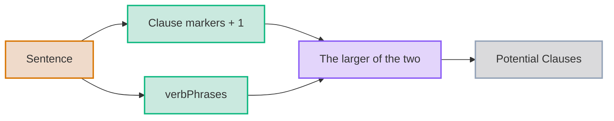

*Each signal covers the other's blind spot: markers miss a series of verbs, and the tagger misses some verbs.*

A plugin rule should treat tags the same way.
Use them to narrow what a rule looks at, and keep any message a suggestion rather than a verdict.

## The Concept File

A project declares its vocabulary in a Concept File, and the gates read it once per run.
It follows the glossary template that this repo's own [GLOSSARY.md](../GLOSSARY.md) uses.

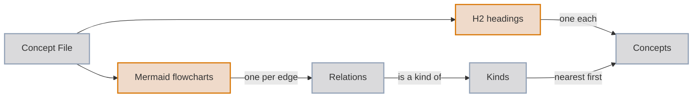

*Overview: headings name the concepts, diagram edges relate them, and "is a kind of" edges build the hierarchy.*

<details>
<summary>Detail: every step of the parse, and every way it fails</summary>

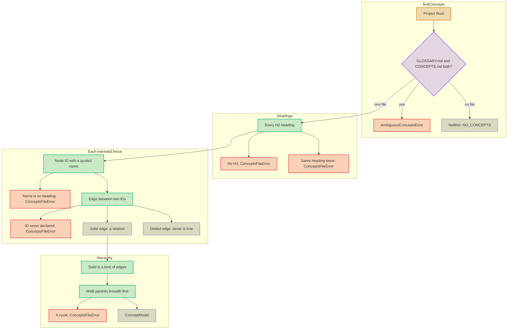

*Detail: each error stops the run with exit code 2, since a rule should never read half a vocabulary.*

</details>

The parser reads only what it needs from the file.

- **Node IDs are local to one diagram.** Two diagrams may reuse an ID for different concepts.
- **Lines that are neither a node nor an edge are skipped.** `classDef` lines and comments do no harm.
- **The edge label is the verb.** An unlabelled edge is a relation with an empty verb.
- **A dotted "is a kind of" builds no hierarchy.** It says one concept must never be a kind of the other.

Here is a small Concept File and the model read from it.

````markdown title="GLOSSARY.md"
# Glossary

The terms of a small tool.

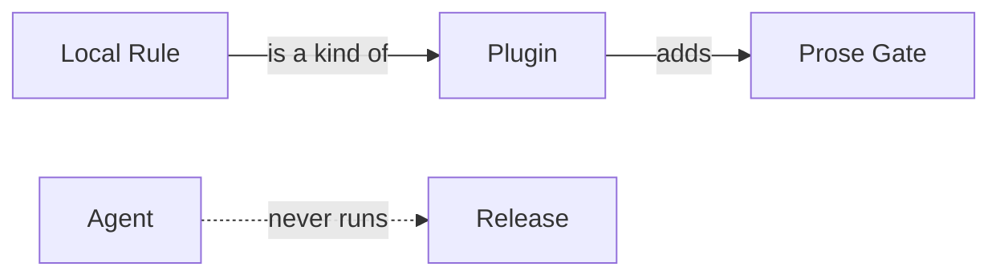

## Agent

An automated contributor.

## Local Rule

A rule file in the project.

## Plugin

A package of rules.

## Prose Gate

One check over markdown.

## Release

A published version.
````

```json title="Concept model"
{
  "file": "GLOSSARY.md",
  "concepts": [
    { "name": "Agent", "kinds": [] },
    { "name": "Local Rule", "kinds": ["Plugin"] },
    { "name": "Plugin", "kinds": [] },
    { "name": "Prose Gate", "kinds": [] },
    { "name": "Release", "kinds": [] }
  ],
  "relations": [
    { "from": "Local Rule", "verb": "is a kind of", "to": "Plugin", "never": false },
    { "from": "Plugin", "verb": "adds", "to": "Prose Gate", "never": false },
    { "from": "Agent", "verb": "never runs", "to": "Release", "never": true }
  ]
}
```

Concepts keep the order of their headings, and relations keep the order of their edges.
The hierarchy is the one derived field, so a Local Rule is a kind of Plugin.

## Finding concepts in a sentence

Each sentence lists the Concept Mentions in it, in `sentence.concepts`.
The matcher works on the words compromise already tokenised, so it never splits a word differently from the tagger.

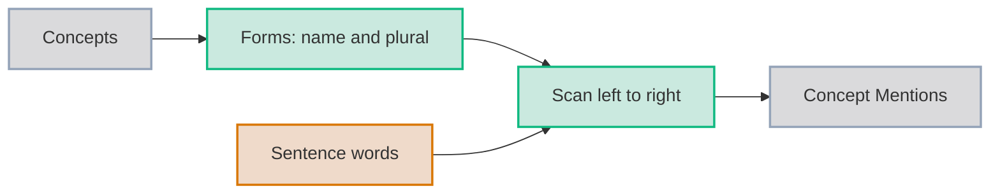

*Overview: every concept becomes a set of word sequences, and the scan looks for them in each sentence.*

<details>
<summary>Detail: the forms and the scan</summary>

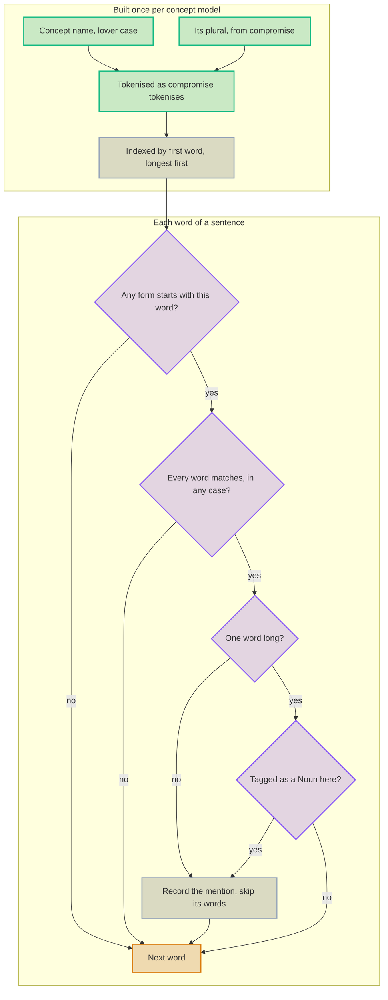

*Detail: the longest form wins, and mentions never overlap.*

</details>

Three choices shape what counts as a mention.

- **Longest first.** With both Rule and Local Rule defined, "local rule" names Local Rule once, never Rule as well.
- **A one-word concept must be a noun.** "release the package" uses a verb, so it names no Release.
- **A multi-word concept needs no tag check.** Two or more words in a row are specific enough on their own.

Here is a sentence read against the Concept File above.

```text title="Sentence"
Each local rule adds prose gates, and an agent may release the package.
```

```json title="Concept mentions"
[
  { "concept": "Local Rule", "text": "local rule", "start": 1, "length": 2, "kinds": ["Plugin"] },
  { "concept": "Prose Gate", "text": "prose gates", "start": 4, "length": 2, "kinds": [] },
  { "concept": "Agent", "text": "agent", "start": 8, "length": 1, "kinds": [] }
]
```

`start` and `length` count words of `sentence.words`, so `words[1]` and `words[2]` are "local" and "rule".
`text` keeps the sentence's own spelling, which is what a Title Case rule compares against the concept's name.
[Writing plugins and local rules](plugins.md#concepts) has that rule in full.

## Cohesion and Topic Breaks

paragraph-sentence-budget-exceeded reads the Language View to say where a long paragraph should break.
It scores the Cohesion of every gap between two sentences, then plans breaks from the scores.

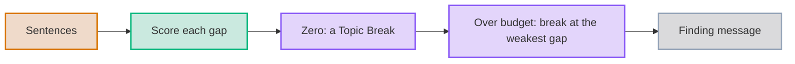

*Overview: a gap with no Cohesion is a new topic, and a topic still over budget splits where it holds together least.*

<details>
<summary>Detail: the four parts of a gap's score, and the break plan</summary>

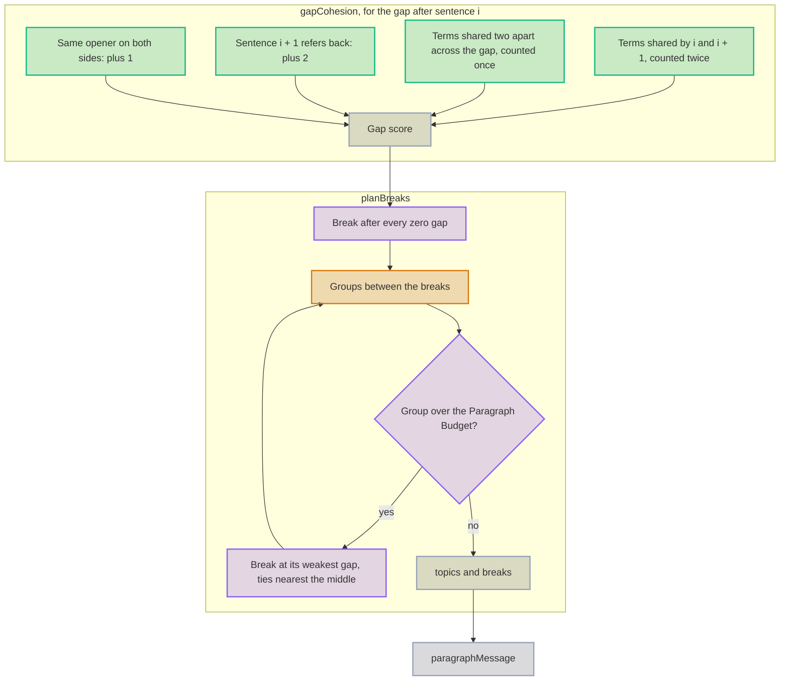

*Detail: a gap at either end has only one pair two apart, so that pair counts double and an edge never looks weakest.*

</details>

Each part of the score comes from one field of the Language View.

| Part | Field it reads | Why it signals one topic |
|---|---|---|
| Shared terms between neighbours | `terms` | Two sentences about the same thing reuse its words |
| Shared terms two apart | `terms` | A sentence that strays for a moment does not split a topic |
| Refers back | `refersBack` | "It", "Its" and "Then" lean on the sentence before |
| Parallel openers | `opener` | Sentences that open alike are often items of one series |

Here is a paragraph over the Paragraph Budget, its gap scores and the message the rule reports.

```text title="Paragraph"
A fixer proposes an edit. The edit claims an expectation. It is checked before it is applied. Plugins load from the project root. A plugin declares a namespace. Its rules carry that namespace as a prefix. The namespace keeps two plugins apart.
```

```json title="Cohesion"
{
  "cohesion": [2, 2, 0, 2, 6, 6],
  "topics": 2,
  "breaks": [3],
  "message": "paragraph has 7 sentences (budget 5) and about 2 topics; break it after sentence 3, one topic per paragraph"
}
```

The third gap scores zero.
Sentences 3 and 4 share no term, neither do the pairs two apart, and sentence 4 does not refer back.
That one Topic Break leaves two groups, of three and four sentences.
Both are within the budget, so the plan needs no further break.

Sentence 3 shares no term with sentence 2, yet its gap scores two.
It opens with "It", so it refers back, and that alone holds the two together.

## Who reads what

| Reader | Fields it reads | What it does with them |
|---|---|---|
| sentence-word-budget-exceeded | `sentences`, `text`, `verbPhrases` | Counts words per sentence, and Potential Clauses for the split it suggests |
| paragraph-sentence-budget-exceeded | `sentences`, `terms`, `opener`, `refersBack` | Counts sentences, scores Cohesion and plans Topic Breaks |
| A plugin rule | Any field, and `doc.concepts` | Anything a project needs, such as a Title Case check on its own terms |

The two built-in readers never read `concepts`.
The concept model exists for plugins, so a project can gate its own dialect without a tagger of its own.

## Limits

- **The tagger is pinned.** compromise is held at an exact version in `package.json`, so a finding never moves under an upgrade.
- **A pinned tagger is still a tagger.** Its tags become something a plugin relies on, so a deliberate upgrade can move a plugin's findings.
- **A text view is a fragment.** Emphasis or a link splits a sentence across several text views, so read a paragraph's view for whole sentences.
- **A view sees one paragraph.** A rule that needs sentences across paragraphs needs a document-level view, and a new Decision Record.
- **Concepts come from one file at the root.** A project that needs several needs a config key, and a new Decision Record.
- **A glossary edit can move findings.** A concept rule's findings depend on a file other than the one checked.

See [PRS-0033](../adrs/0033-a-paragraph-carries-a-lazy-language-view.md), [PRS-0036](../adrs/0036-a-glossary-is-read-as-the-concept-model.md) and [PRS-0039](../adrs/0039-a-text-carries-a-lazy-language-view.md) for the decisions behind each limit.
